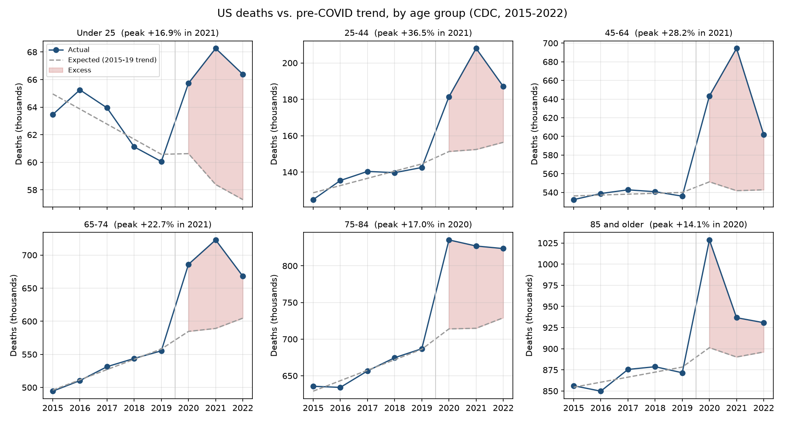

# Senior Mortality Shift: CDC Excess Deaths Analysis

[](https://github.com/nickwalker-data/Senior-Mortality-Project/actions/workflows/dbt-daily.yml)

Did COVID-19 change *who* was dying in the US? This project pulls CDC weekly
mortality data for 2015–2022, builds a pre-COVID trend baseline for each age
group, and measures excess deaths. The finding: in 2021, excess mortality
shifted toward working-age adults.

## Key findings

- **About 1.28 million excess deaths in 2020–2022**, measured against a fitted 2015–2019 trend.
  CDC's 2020 runs 53 weeks, so its baseline is scaled to 53 weeks too; without that
  adjustment the extra week would add about 56,000 deaths that are not excess.
- **Ages 25–44 peaked at +36.5% above trend in 2021**, the year of the Delta wave.
- **Ages 85+ ran just +5.2% above trend in 2021.**
- People 65+ made up roughly 73–74% of deaths every year, then **dropped to 71.9% in 2021**.
- A trend baseline matters. Deaths were already rising before COVID as the
  population aged, so a flat 2015–2019 average overstates excess deaths
  (ages 25–44 show +52% against the flat average vs +36.5% against the trend).



## How it works

| Step | File | What it does |
| --- | --- | --- |
| 1. Extract | `cdc_mortality_pull.py` | Pulls CDC data from the Socrata REST API, aggregating server-side with SoQL so about 48 rows download instead of about 200,000. Cleans it with pandas, merges NYC into NY, and checks a known total (2015, ages 25–44 = 124,889) before saving. Also counts the weeks in each CDC year (52, or 53 for 2020) and writes them to a dbt seed. |
| 2. Load + SQL | Google BigQuery | Loads both CSVs into BigQuery (dataset `CDC`) and compares deaths with a 2015–2019 baseline using CTEs and joins. |
| 3. Model | `cdc_trend_analysis.py` | Fits a 2015–2019 linear trend per age group (statsmodels OLS) on deaths scaled to a 52-week basis, projects expected deaths for 2020–2022 scaled to each year's week count, computes excess deaths with NumPy, and charts actual vs expected with matplotlib. |
| 4. Transform + test | `cdc_dbt/` (dbt on BigQuery) | Rebuilds the analysis as tested SQL models: staging views over the raw tables, an excess-deaths mart that fits the same week-adjusted trend in SQL, a state-level 65+ mart with a within-year rank, and a dashboard mart shaped for Tableau. 43 automated data tests run on every build. |

### dbt layer

```
raw (BigQuery dataset CDC)              seed: cdc_weeks_per_year (52/53 weeks)
  ├─ stg_us_deaths_by_age_year ──► fct_excess_deaths_by_age ──┐
  └─ stg_state_deaths_65plus ────► fct_state_65plus_excess ───┴─► mart_senior_dashboard
```

| Test | What it proves |
| --- | --- |
| Uniqueness and not-null on every model's grain | One row per year + age group, one row per state + year, no gaps |
| Accepted values on `age_group` | Only the six CDC age bands appear |
| `assert_2015_ages_25_44_matches_cdc` | The load matches a published CDC figure (124,889) |
| `assert_excess_2020_2022_matches_python` | The SQL trend baseline reproduces the Python/statsmodels total (1,279,633) |
| Accepted values on `weeks_in_year`, plus not-null wherever it's joined | Every year has a week count of 52 or 53, and no year silently drops out of the baseline |
| `assert_dashboard_row_counts` | The dashboard mart has 1 total, 3 age-group and 51 state rows per year, for 2015–2022 only (a partial 2023 fails the build) |
| `assert_dashboard_total_matches_direct_fit` | Adding up the three senior age groups' trends gives the same 65+ baseline as fitting 65+ directly |
| `assert_dashboard_states_reconcile_to_total` | The state map's excess deaths add up to the national 65+ excess within 0.1% |
| `assert_states_reconcile_to_national_65plus` | The 51 jurisdictions' 65+ deaths add up to the national 65+ total within 0.05% (they agree within about 0.01%; the gap is CDC rounding of weighted estimates per state and week) |
| `assert_raw_row_counts` | The raw tables are complete: 48 national rows and 408 state rows |

### Scheduled runs (GitHub Actions)

`.github/workflows/dbt-daily.yml` runs `dbt build` every day at 6 AM Eastern, on every push that changes the dbt project, and on demand from the Actions tab. If any of the 43 tests fails, the run fails and GitHub flags it. The BigQuery service-account key is stored as the `GCP_SA_KEY` repository secret and written to a temp file only for the run; `cdc_dbt/ci/profiles.yml` reads its path from an environment variable, so no credentials are committed.

**Outputs:** `us_deaths_by_age_year.csv`, `state_deaths_65plus.csv`,
`excess_deaths_trend_baseline.csv`, `excess_deaths_by_age.png`,
`cdc_dbt/seeds/cdc_weeks_per_year.csv`

## Run it yourself

```
pip install -r requirements.txt
python cdc_mortality_pull.py
python cdc_trend_analysis.py
```

For the dbt layer: `pip install dbt-bigquery`, set up a BigQuery service-account profile in `~/.dbt/profiles.yml` (kept outside this repo), then from `cdc_dbt/` run `dbt build`.

## Data source

CDC, *Weekly Counts of Deaths by Jurisdiction and Age* (dataset `y5bj-9g5w`),
"Predicted (weighted)" counts, 2015–2022.

## Limitations

- A linear trend fit on five years is a simple baseline. The 45–64 fit is weak (R² = 0.13), so read that group's excess with caution.
- Recent CDC counts are revised over time, so totals may shift slightly between pulls.

## Roadmap

- [x] Python REST API extraction with validation
- [x] BigQuery load and baseline SQL
- [x] Trend baseline, excess deaths and chart
- [x] dbt models and data tests on BigQuery
- [ ] Tableau / Power BI dashboard on the dbt marts
- [x] Scheduled runs with GitHub Actions (daily `dbt build` with all data tests; first green run Nov 17, 2026)
- [ ] Natural-language question → SQL tool over the BigQuery tables
